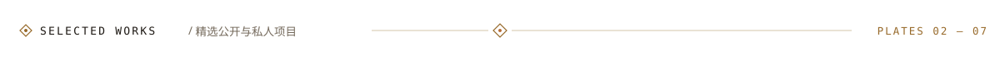

<!-- AXIS Observatory // Star GitHub Exhibition Profile -->

<a href="https://axis-10d38158.maozi.io/"><picture><source media="(max-width: 600px) and (prefers-color-scheme: dark)" srcset="./assets/atelier/dark/hero-mobile.svg"/><source media="(max-width: 600px)" srcset="./assets/atelier/light/hero-mobile.svg"/><source media="(prefers-color-scheme: dark)" srcset="./assets/atelier/dark/hero.svg"/></picture></a>

<a href="https://github.com/startuo/Axis-EVO"><picture><source media="(max-width: 600px) and (prefers-color-scheme: dark)" srcset="./assets/atelier/dark/flagship-axis-evo-mobile.svg"/><source media="(max-width: 600px)" srcset="./assets/atelier/light/flagship-axis-evo-mobile.svg"/><source media="(prefers-color-scheme: dark)" srcset="./assets/atelier/dark/flagship-axis-evo.svg"/></picture></a>

<picture><source media="(max-width: 600px) and (prefers-color-scheme: dark)" srcset="./assets/atelier/dark/divider-works-mobile.svg"/><source media="(max-width: 600px)" srcset="./assets/atelier/light/divider-works-mobile.svg"/><source media="(prefers-color-scheme: dark)" srcset="./assets/atelier/dark/divider-works.svg"/></picture>

<a href="https://axisguanwang-gjs9q0158.maozi.io/"><picture><source media="(prefers-color-scheme: dark)" srcset="./assets/atelier/dark/card-axis-nex.svg"/></picture></a> <a href="https://axis-10d38158.maozi.io/"><picture><source media="(prefers-color-scheme: dark)" srcset="./assets/atelier/dark/card-visual-space.svg"/></picture></a>

<a href="https://axis.1669338073.workers.dev/"><picture><source media="(prefers-color-scheme: dark)" srcset="./assets/atelier/dark/card-axis-blog.svg"/></picture></a> <a href="https://github.com/startuo/Axis-Business-Intelligence"><picture><source media="(prefers-color-scheme: dark)" srcset="./assets/atelier/dark/card-axis-bi.svg"/></picture></a>

<a href="https://github.com/startuo/dsh-our-free-model"><picture><source media="(prefers-color-scheme: dark)" srcset="./assets/atelier/dark/card-dsh-plugin.svg"/></picture></a> <a href="https://github.com/startuo/k230d-study-vision"><picture><source media="(prefers-color-scheme: dark)" srcset="./assets/atelier/dark/card-k230d.svg"/></picture></a>

<a href="https://axis-10d38158.maozi.io/"><picture><source media="(max-width: 600px) and (prefers-color-scheme: dark)" srcset="./assets/atelier/dark/colophon-mobile.svg"/><source media="(max-width: 600px)" srcset="./assets/atelier/light/colophon-mobile.svg"/><source media="(prefers-color-scheme: dark)" srcset="./assets/atelier/dark/colophon.svg"/></picture></a>

<a href="https://axis-10d38158.maozi.io/">3D 艺术空间</a> &nbsp;/&nbsp; <a href="https://axis.1669338073.workers.dev/">个人博客</a> &nbsp;/&nbsp; <a href="https://5aefz0rpj-star-0vl490158.maozi.io/">国内镜像</a> &nbsp;/&nbsp; <a href="https://axisguanwang-gjs9q0158.maozi.io/">Axis NEX 官网</a> &nbsp;/&nbsp; <a href="https://x.com/star_xiao7920">X</a> &nbsp;/&nbsp; <a href="https://discord.gg/PtujUDxq">Discord</a> &nbsp;/&nbsp; <a href="https://github.com/startuo?tab=repositories">全部仓库</a>

文字版介绍与作品索引

我是 <strong>Star</strong>，以个人项目品牌 <strong>Axis</strong> 持续构建可核验的 AI Agent 系统、开发工具链与 WebGL 视觉作品。

<ul>
<li><a href="https://github.com/startuo/Axis-EVO">Axis-EVO（M9）</a>：本地优先的可核验 AI Agent 工作台，具备任务验收契约、语义停滞拦截、零历史独立只读验证器（Fresh Verifier）、不可变 Skill 版本链、无网络 Linux Docker 沙箱与保守 UNKNOWN 停机栅栏。</li>
<li><a href="https://axisguanwang-gjs9q0158.maozi.io/">Lexis Axis NEX（私人项目 / 官网）</a>：面向 Lexis Menu（GTA V Enhanced）的免费模块化 Lua 菜单引擎，采用五文件按页懒加载、内置原生兼容垫片与液态玻璃界面。</li>
<li><a href="https://axis-10d38158.maozi.io/">AXIS-STAR Visual Space（在线 3D 艺术空间）</a>：从古典雕塑到宇宙星辰的五幕一镜到底 3D 互动个人视觉中转站，基于 Three.js、WebGL2、GLSL 与 Lenis，零外部运行时请求、165 FPS 渲染。</li>
<li><a href="https://axis.1669338073.workers.dev/">Axis Personal Blog</a>（源码：<a href="https://github.com/startuo/Axis">startuo/Axis</a>）：基于 Astro 与 Cloudflare Workers D1 构建的双站博客，记录 Agent、Harness 工程与独立开发实践。</li>
<li><a href="https://github.com/startuo/Axis-Business-Intelligence">Axis Business Intelligence</a>：本地优先的商业与财经信号聚合工作流，覆盖信号抓取、事件聚类评分与人工复核入库。</li>
<li><a href="https://github.com/startuo/dsh-our-free-model">dsh-our-free-model</a>：面向 DeepSeek Harness（dsh）的零配置免费前沿模型路由插件。</li>
<li><a href="https://github.com/startuo/k230d-study-vision">K230D Study Vision</a>：基于嘉楠 K230D 与 YOLOv8n + CanMV MicroPython 的端侧学习状态 AI 视觉识别项目。</li>
</ul>

常用技术栈：Python、TypeScript、React、Three.js / WebGL2、GLSL、Lua、Docker、SQLite。

GitHub 贡献

<picture><source media="(prefers-reduced-motion: reduce) and (prefers-color-scheme: dark)" srcset="./assets/atelier/dark/contributions-static.svg"/><source media="(prefers-reduced-motion: reduce)" srcset="./assets/atelier/light/contributions-static.svg"/><source media="(prefers-color-scheme: dark)" srcset="https://raw.githubusercontent.com/startuo/startuo/output/github-contribution-grid-snake-dark.svg"/></picture>

