<picture>
  <source media="(prefers-color-scheme: dark)" srcset="./assets/banner-dark.svg" />
  <source media="(prefers-color-scheme: light)" srcset="./assets/banner-light.svg" />
  
</picture>

 

### About

Independent builder **Star**, building under the personal project mark **Axis**.  
Focusing on reliable **LLM Agent runtimes**, **verifiable skill governance**, **Harness engineering**, and **WebGL / GLSL visual craft**.

---

### Selected Works

| Project | Focus | Stack |
| :--- | :--- | :--- |
| [**Axis-EVO**](https://github.com/startuo/Axis-EVO) | Local-first trustworthy Agent workbench with immutable skill versioning, approval boundaries, Docker isolation, and receipt auditing | `Python` `TypeScript` `React` |
| [**Axis**](https://github.com/startuo/Axis) | Personal writing and field notes on AI Agents, LLM Harnesses, engineering craft, and independent building | `Astro` `TypeScript` |
| [**XinZhongZhiCheng-skills**](https://github.com/startuo/XinZhongZhiCheng-skills) | Structured narrative distillation skill workflow for Chinese documentary commentary and character storytelling | `Python` `Prompt Engineering` |
| [**Axis-Business-Intelligence**](https://github.com/startuo/Axis-Business-Intelligence) | Local-first business and financial signal clustering, research tracking, and human-reviewed editorial workflow | `JavaScript` `Local Pipeline` |
| [**k230d-study-vision**](https://github.com/startuo/k230d-study-vision) | Embedded desktop study-state AI vision recognition on K230D with YOLOv8n and CanMV MicroPython | `Python` `YOLOv8n` `Embedded` |

---

### Coordinates

[Overseas Blog](https://axis.1669338073.workers.dev/) &nbsp;/&nbsp; [China Blog](https://5aefz0rpj-star-0vl490158.maozi.io/) &nbsp;/&nbsp; [X](https://x.com/star_xiao7920) &nbsp;/&nbsp; [Discord](https://discord.gg/PtujUDxq)
